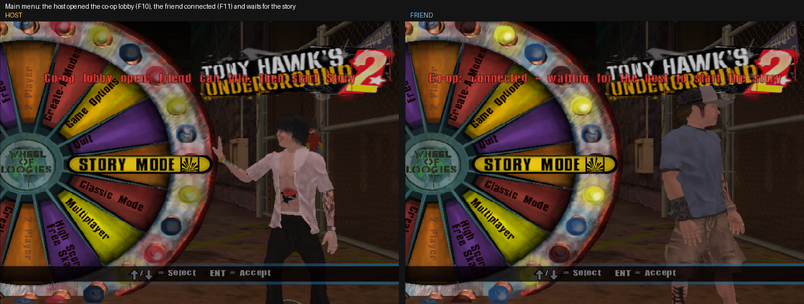
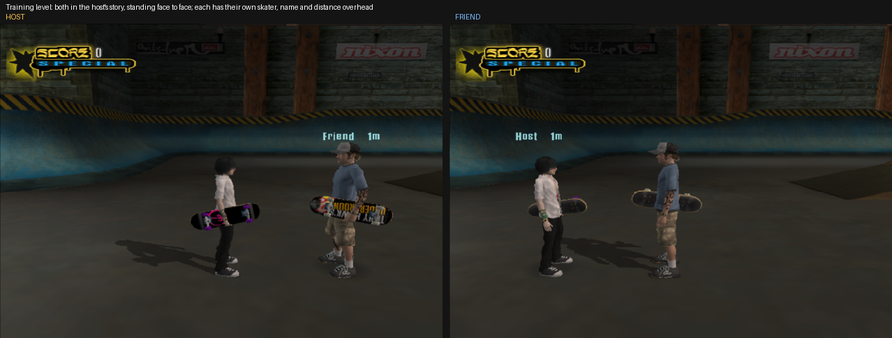
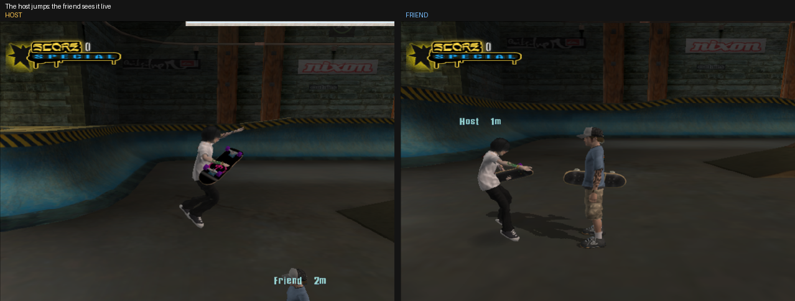
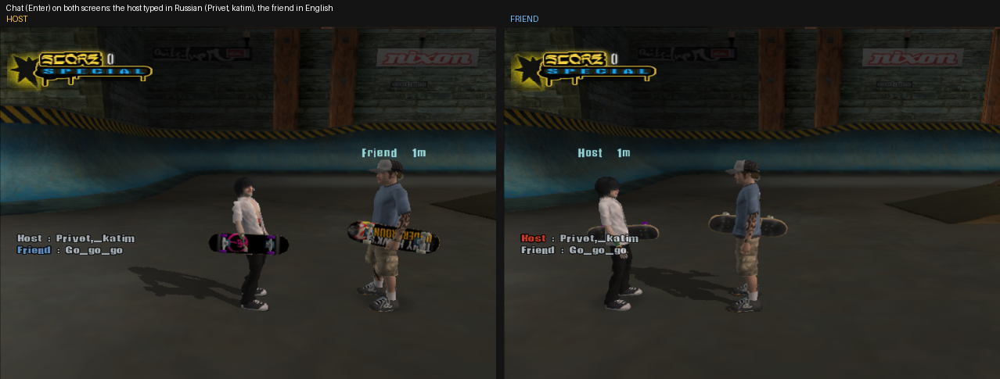
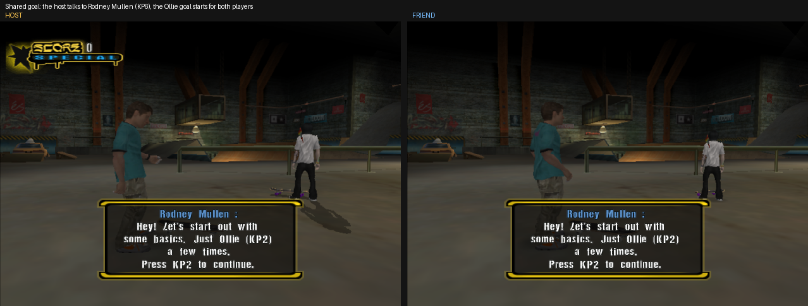
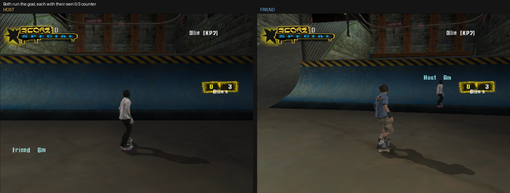
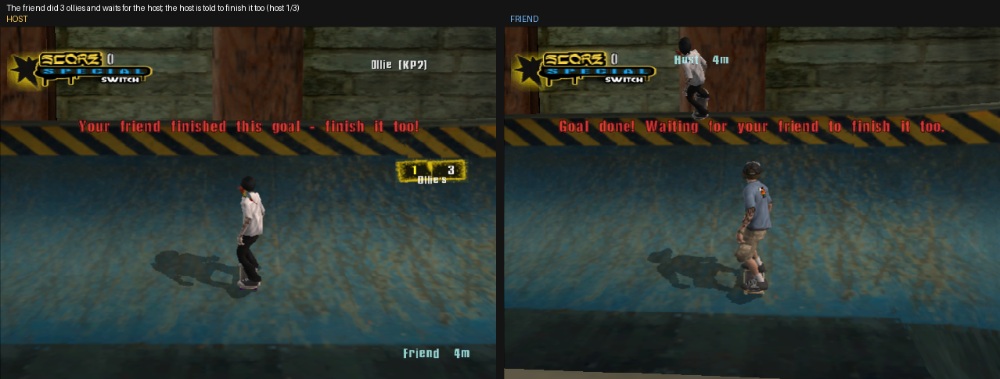
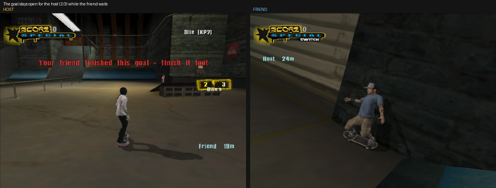
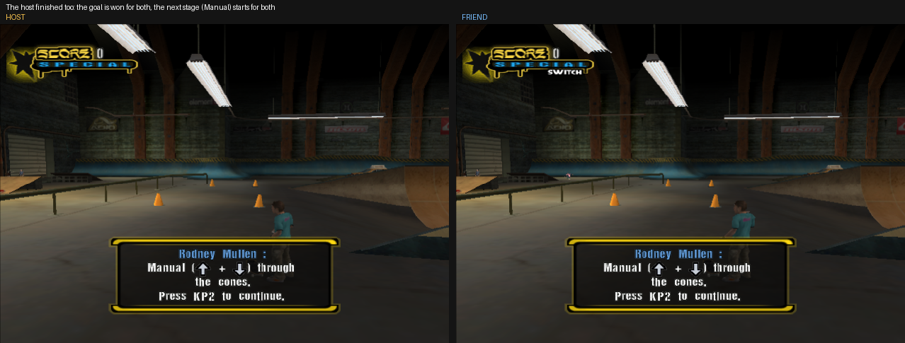

# THUG2 Story Co-op

**[English](#english)** | **[Русский](#русский)**

💸 [Support the author / Отблагодарить автора](https://www.donationalerts.com/r/leftgamerr)

<details>
<summary>Screenshots / Скриншоты</summary>

**Lobby: the host opened co-op, the friend connected / Лобби: хост открыл кооператив, друг подключился**


**Both in the same level / Оба в одном уровне**


**The host's jump on the friend's screen / Прыжок хоста виден у друга**


**Chat: Russian is transliterated by itself / Чат: русский текст сам пишется латиницей**


**The friend took a goal from an NPC, it started for both / Друг взял задание у NPC, оно запустилось у обоих**


**Both play the goal / Оба проходят задание**


**The friend finished and waits for the host / Друг выполнил и ждёт хоста**


**The host finishing the goal / Хост доделывает задание**


**The goal is won for both / Задание засчитано обоим**


</details>

---

## English

Online co-op for two in the **Tony Hawk's Underground 2** (PC) story, on top of **THEMOD 1.3**.
The host plays their own Story Mode; the friend joins the host's game and skates alongside in the same level:
NPCs, cutscenes, goals.

### Features

- The friend gets the host's story (chapters, won goals, world flags) on joining and on every level change.
- Cutscenes and goal cameras play for both; a skip (Esc / num2) by either player skips them for both.
- Shared goals: a goal one player takes starts for both and is won once both have done it.
- Your friend's name and distance over their skater (visible through walls), teleport to your friend,
  chat with Cyrillic transliteration.
- Guest characters and the pro teammate are synced.
- Optional skater collision (`player_collision=1`).

### Install

You need Tony Hawk's Underground 2 for PC. Both players install the mod. THEMOD 1.3 doesn't have to be installed:
the archive has everything for it.

> **About THEMOD 1.3.** The co-op is built on THEMOD 1.3, and the patcher reproduces its installer. I couldn't find
> THEMOD's author or anywhere to download it (its site thmods.com is gone), so we made our own patcher: it turns
> your own `THUG2.exe` into `THEMOD 1.3.exe` (the same 126 bytes THEMOD's installer changes), and THEMOD's
> `thethug2mod.prx` comes in the archive. If you know the author, a download link or other resources, please
> [open an issue](https://github.com/LeftGamer1/thug2-coop/issues).

1. Download `thug2-coop.zip` from [Releases](https://github.com/LeftGamer1/thug2-coop/releases).
2. If you have THEMOD already, keep a copy of your `Data\pre\thethug2mod.prx`.
3. Unpack the archive into the game folder (the one with `THUG2.exe`), replacing files.
4. No `THEMOD 1.3.exe` there? Run `patch_themod.bat`: it makes it from `THUG2.exe` (which stays as it is).
   Start the game with `THEMOD 1.3.exe`.
5. In `coop.ini` set `name=` (both) and `host_address=` (the friend only).
6. The host's UDP 5153 and TCP 5154 must be reachable (Radmin VPN / ZeroTier / Porthole).

Details: [README_EN.txt](README_EN.txt) (settings, controls, limits, troubleshooting).

### Controls

| Key | Action |
|---|---|
| F10 | host: open co-op |
| F11 | friend: join |
| F12 | teleport to your friend |
| Enter | chat |

The keys can be changed in `coop.ini`, section `[keys]`.

### Build

- `src/`: `dinput8.dll` (a proxy that patches the game at load time), C++17, MinGW i686.
- `patcher/`: `patch_themod.bat` / `.ps1`, makes `THEMOD 1.3.exe` from `THUG2.exe`.
- `qb/coop.ns`: game scripts in [NeverScript](https://github.com/byxor/NeverScript), compiled to `coop.qb`
  and added to THEMOD's `thethug2mod.prx`.

```bash
docker build -t thug2coop-mingw:1 tools/
./build.sh                                   # out/dinput8.dll
NS=/path/to/ns ORIG_PRX=/path/to/thethug2mod.prx GAME=/path/to/Game ./install.sh
./pack.sh                                    # out/thug2-coop.zip
```

### License

MIT, see [LICENSE](LICENSE). Tony Hawk's Underground 2 belongs to Activision, THEMOD to its authors.

### Credits

Made with [Claude Opus 5.5](https://www.anthropic.com/claude) in Claude Code, following the
[coop-anything](https://github.com/cranebeaker/coop-anything) playbook.

### Support

Like the mod? [Support the author](https://www.donationalerts.com/r/leftgamerr)

---

## Русский

Кооператив для сюжета **Tony Hawk's Underground 2** (PC) по сети, вдвоём, поверх **THEMOD 1.3**.
Хост играет свой Story Mode, друг заходит в его игру и катается рядом в том же уровне: NPC, катсцены, задания.

### Что умеет

- Друг получает сюжет хоста (главы, выполненные цели, флаги мира) при входе и при каждой смене уровня.
- Катсцены и камеры целей идут у обоих, пропуск (Esc / num2) у любого пропускает у обоих.
- Общие задания: взятое одним задание запускается у обоих и засчитывается, когда его выполнят оба.
- Имя и расстояние над другом (видно сквозь стены), телепорт к другу, чат с транслитом кириллицы.
- Гостевые персонажи и напарник-профи синхронизируются.
- Коллизия скейтеров по желанию (`player_collision=1`).

### Установка

Нужна Tony Hawk's Underground 2 для PC. Мод ставят оба игрока. Ставить THEMOD 1.3 заранее не нужно:
всё для него есть в архиве.

> **Про THEMOD 1.3.** Кооператив сделан на основе THEMOD 1.3, и патчер повторяет его установщик. Мы не нашли ни
> автора THEMOD, ни где его скачать (его сайт thmods.com больше не работает), поэтому решили сделать свой патчер:
> он превращает ваш `THUG2.exe` в `THEMOD 1.3.exe` (те же 126 байт, что меняет установщик THEMOD), а
> `thethug2mod.prx` от THEMOD лежит в архиве. Если знаете автора, ссылку на скачивание или другие ресурсы —
> [напишите в Issues](https://github.com/LeftGamer1/thug2-coop/issues).

1. Скачайте `thug2-coop.zip` из [Releases](https://github.com/LeftGamer1/thug2-coop/releases).
2. Если THEMOD уже стоит — сохраните свой `Data\pre\thethug2mod.prx`.
3. Распакуйте архив в папку игры (где лежит `THUG2.exe`) с заменой.
4. Нет `THEMOD 1.3.exe`? Запустите `patch_themod.bat`: он сделает его из `THUG2.exe` (сам `THUG2.exe` не меняется).
   Игру запускайте через `THEMOD 1.3.exe`.
5. В `coop.ini` впишите `name=` (оба) и `host_address=` (только друг).
6. У хоста должны быть доступны UDP 5153 и TCP 5154 (Radmin VPN / ZeroTier / Porthole).

Подробно — в [README_RU.txt](README_RU.txt): настройки, управление, ограничения, решение проблем.

### Управление

| Клавиша | Действие |
|---|---|
| F10 | хост: открыть кооператив |
| F11 | друг: подключиться |
| F12 | телепорт к другу |
| Enter | чат |

Клавиши меняются в `coop.ini`, раздел `[keys]`.

### Сборка

- `src/` — `dinput8.dll` (прокси, патчит игру при загрузке), C++17, MinGW i686.
- `patcher/` — `patch_themod.bat` / `.ps1`, делает `THEMOD 1.3.exe` из `THUG2.exe`.
- `qb/coop.ns` — скрипты игры на [NeverScript](https://github.com/byxor/NeverScript), компилируются в `coop.qb`
  и добавляются в `thethug2mod.prx` THEMOD.

Команды сборки — выше, в разделе [Build](#build).

### Лицензия

MIT, см. [LICENSE](LICENSE). Tony Hawk's Underground 2 принадлежит Activision, THEMOD — его авторам.

### Благодарности

Сделано под руководством [Claude Opus 5.5](https://www.anthropic.com/claude) в Claude Code, по методике
[coop-anything](https://github.com/cranebeaker/coop-anything).

### Поддержка

Понравился мод? [Отблагодарить автора](https://www.donationalerts.com/r/leftgamerr)
